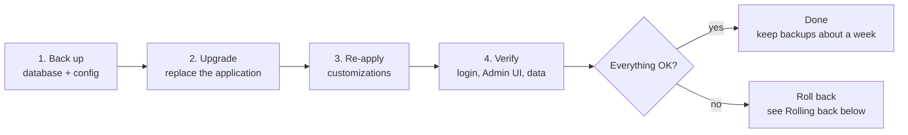
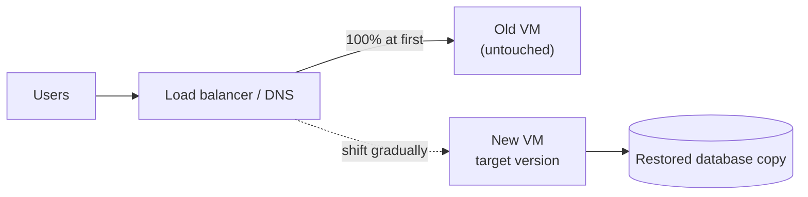

# Gluu Flex upgrade guide

How to upgrade a running **Gluu Flex** server (Janssen + Admin UI) from an older release to a newer one **without losing data**.

> [!NOTE]
> Last updated 2026-10-23 · Author: Zico, Gluu Support · Tested upgrade: **Flex 6.4.0 → 6.5.1** (Kubernetes and VM) · Script: `flex-k8s-upgrade.sh` v1.1.0

## Contents

1. [What this guide covers](#what-this-guide-covers)
2. [Pick your path](#pick-your-path)
3. [Before you start (every path)](#before-you-start-every-path)
4. [Path K: Kubernetes (Helm)](#path-k-kubernetes-helm)
5. [Path V1: VM, in-place](#path-v1-vm-in-place)
6. [Path V2: VM, side-by-side](#path-v2-vm-side-by-side)
7. [Path V3: Admin UI only](#path-v3-admin-ui-only)
8. [After the upgrade: verify](#after-the-upgrade-verify)
9. [Rolling back](#rolling-back)
10. [Problems you may hit](#problems-you-may-hit)
11. [Glossary](#glossary)
12. [Sources](#sources)

---

## What this guide covers

A Flex server is made of three things. An upgrade replaces the first two and keeps the third:

| Part | What it is | During an upgrade |
| --- | --- | --- |
| **Application** | Janssen services (auth server, config API, SCIM, FIDO2) and Flex (Admin UI, Casa) | Replaced with the new version |
| **Data** | Users, clients, scopes, settings, Admin UI roles, stored in PostgreSQL or MySQL | **Kept** (back it up first) |
| **Your customizations** | Custom login pages, branding, Agama flows, scripts, mounted config files | **Re-check** after the upgrade; some are overwritten |

Every path in this guide follows the same five steps:



## Pick your path

Find your setup in the first column and follow the link.

| Your setup | Path | Tested by us? | Downtime | What you do |
| --- | --- | --- | --- | --- |
| Kubernetes, Helm chart | [**Path K**](#path-k-kubernetes-helm) | ✅ Yes (quickstart `gluu-all-in-one` chart) | about 2 minutes | Run a script, or `helm upgrade` by hand |
| VM, one server, simplest | [**Path V1**](#path-v1-vm-in-place) | ✅ Yes (Ubuntu 24.04, PostgreSQL) | a few minutes | Install the new package, swap the application files |
| VM, production, safest | [**Path V2**](#path-v2-vm-side-by-side) | ⚠️ No (documented by Janssen) | close to zero | Build a new server next to the old one, then move traffic |
| Only the Admin UI changed | [**Path V3**](#path-v3-admin-ui-only) | ✅ Yes | seconds | One command |

> [!IMPORTANT]
> Rehearse on a staging copy first. Treat the release notes of every version between yours and the target as the authority on breaking changes.

---

## Before you start (every path)

### Checklist

- [ ] You know your **current** and **target** versions, and you read the release notes in between.
- [ ] You have a **staging copy** (same OS, database and version) to rehearse on.
- [ ] A **maintenance window** is agreed.
- [ ] You listed your **customizations**: custom pages and branding, Agama projects, custom scripts, `jans-auth` properties, Admin UI roles. Upgrades do **not** update custom scripts.
- [ ] You listed what **outside parties depend on**: clients, scopes, trusted IdPs, SAML trusts, signing keys (JWKS).
- [ ] You have **database admin access** and enough disk for a full dump.
- [ ] You have the **admin credentials**, and a way to reach the server (SSH or `kubectl`).

### Back up

Take **all** of these before touching anything. A VM snapshot is the best single backup; the rest protects against a bad snapshot. Never put the secret backup in a ticket or a repository.

<details>
<summary><strong>VM backup commands</strong></summary>

1. Snapshot the VM (VMware, DigitalOcean, your cloud provider).
2. Stop the Janssen services, archive the files, start the services again. The [Janssen backup page](https://docs.jans.io/head/janssen-server/vm-ops/backup/) lists `/opt`, `/etc/jans`, `/etc/apache2` and `/var/jans`:

```bash
sudo systemctl stop 'jans*'
sudo tar cvf jans-backup.tar /opt/jans /etc/jans /etc/apache2 /var/jans
sudo systemctl start 'jans*'
```

The Janssen docs print the stop and start commands as `systemctl stop list-units --all "jans*"`, which is not valid as written. Check that the services really stop.

3. Dump the database (the official docs do not cover this):

```bash
# MySQL
mysqldump --single-transaction --routines -u <user> -p jans > jans-$(date +%F).sql
# PostgreSQL
pg_dump -U <user> -Fc jans > jans-$(date +%F).dump
```

4. Save the Admin UI directory (`<apache root>/admin`) and `/var/log/adminui`.

</details>

<details>
<summary><strong>Kubernetes backup commands</strong> (from the <a href="https://docs.jans.io/head/janssen-server/kubernetes-ops/backup-restore/">Janssen backup guide</a>)</summary>

```bash
kubectl -n <namespace> get cm cn -o yaml     > configmap-backup.yaml
kubectl -n <namespace> get secret cn -o yaml > secret-backup.yaml
helm get values <release> -n <namespace>     > values-live.yaml
helm list -n <namespace>                       # note the chart version
kubectl -n <namespace> exec <postgresql-pod> -- pg_dump -U postgres -Fc gluu > gluu-pre-upgrade.dump
```

For an external database, dump it with its own tools. The Kubernetes script in Path K does all of this for you.

</details>

---

## Path K: Kubernetes (Helm)

**Use this if** Flex runs on Kubernetes from a Helm chart. **Tested on:** microk8s, chart `gluu-flex/gluu-all-in-one`, PostgreSQL in the cluster, 6.4.0 → 6.5.1. Result: data unchanged (12 persons, 10 clients, 195 scopes), all four Janssen components moved to 2.5.0, Admin UI, login pages and a custom Agama flow worked afterwards.

> [!WARNING]
> The production chart `gluu-flex/gluu` has not been tested. It uses one image tag per service, which the script does not edit.

### K1. The quick way: use the script

[`flex-k8s-upgrade.sh`](../flex-k8s-upgrade.sh) does the whole procedure and prints the rollback commands. **Always run the dry run first.** It takes the backup and runs `helm upgrade --dry-run` but changes nothing.

```bash
# 1. Dry run
sudo bash flex-k8s-upgrade.sh -v 6.5.1 -f override-6.4.0.yaml -k /root/.kube/config -d

# 2. Real run (add -a to redeploy your customized Agama project afterwards)
sudo bash flex-k8s-upgrade.sh -v 6.5.1 -f override-6.4.0.yaml -k /root/.kube/config \
     -a agama-pw=agama-pw-gluu.gama -y
```

What the script does, in order:

| Step | What happens |
| --- | --- |
| Preflight | Checks the Helm release and the target chart exist; lists files you mounted over the image |
| Image tag | Writes a copy of your values file (`<values>-<version>.yaml`) with the target chart's default `image.tag` |
| Backup | ConfigMap and Secret `cn`, Helm values and history, your custom ConfigMaps, a `pg_dump` |
| Dry run | `helm upgrade --dry-run` |
| Upgrade | `helm upgrade --wait --atomic` (rolls back by itself if the pods never become ready) |
| Agama | Redeploys the projects you list with `-a` |
| Verify | Discovery, `/admin/`, `/admin/home/dashboard` return 200; WAR versions; database row counts before and after |

<details>
<summary><strong>All script options</strong></summary>

| Option | Meaning | Default |
| --- | --- | --- |
| `-v` | target chart version (**required**) | |
| `-f` | current values file (**required**) | |
| `-r`, `-n` | Helm release, namespace | `flex`, `gluu` |
| `-c` | chart | `gluu-flex/gluu-all-in-one` |
| `-t` | image tag | the target chart's default `image.tag` |
| `-b` | backup directory | `~/flex-upgrade-backups` |
| `-p`, `-U`, `-D` | PostgreSQL pod, user, database | auto-detect, `postgres`, `gluu` |
| `-s` | skip the database dump (you dump an external database yourself first) | off |
| `-a NAME=FILE` | redeploy an Agama project archive afterwards (repeatable) | none |
| `-k` | kubeconfig path (also passed to Helm) | current context |
| `-w` | rollout timeout | `900s` |
| `-d` | dry run | off |
| `-y` | no confirmation prompt | off |
| `-V`, `-h` | print version, print help | |

</details>

**Not covered by the script:** comparing the files you mount over the image with the new image (it only lists them, see K2 step 3), MySQL or external-database dumps, the production chart, and VM installs.

### K2. The manual way (what the script automates)

1. **Back up** (see [Before you start](#before-you-start-every-path)).
2. **Update the image tag in your values file.** The chart version and the image tag are different numbers (chart `6.5.1`, image `6.5.1-1`). If your values pin `image.tag: 6.4.0-1`, the upgrade keeps running the old image. Find the default with:

   ```bash
   helm show values gluu-flex/gluu-all-in-one --version 6.5.1 | grep -A6 '^image:'
   ```

3. **Check every file you mount over the image.** A mounted file hides the new image's version of that file. Run a temporary pod from the new image, `cat` each file, and compare. In our test: the `login.xhtml` override was identical upstream (kept), the nginx file still needed our fix (kept), and the status script was fixed upstream (mount removed).
4. **Upgrade:**

   ```bash
   helm repo update
   helm upgrade flex gluu-flex/gluu-all-in-one -n gluu -f override-6.5.1.yaml --version=6.5.1
   kubectl -n gluu rollout status deploy/flex-gluu-all-in-one
   ```

5. **Redeploy customized Agama projects.** The upgrade redeploys the stock `agama-pw` (and Casa), which overwrites custom branding. Deploy your archive again:

   ```bash
   curl -k -H "Authorization: Bearer $TOKEN" -H "Content-Type: application/zip" \
        --data-binary @agama-pw-gluu.gama \
        "https://<fqdn>/jans-config-api/api/v1/agama-deployment/agama-pw?autoconfigure=false"
   ```

   A separate project (for example `gluu-terms`) is kept.
6. **Verify** with [the checklist below](#after-the-upgrade-verify).

---

## Path V1: VM, in-place

**Use this if** Flex runs on one VM and you accept a few minutes of downtime. **Tested on:** Ubuntu 24.04, PostgreSQL, Flex 6.4.0 → 6.5.1 (Janssen 2.4.0 → 2.5.0). Result: services, data, Admin UI and token issuance all worked; the database was not touched, so no restore was needed.

> [!WARNING]
> Janssen's own docs say VM deployments have no automatic upgrade and recommend [Path V2](#path-v2-vm-side-by-side). The in-place route below worked for this version pair. The database schema did not change between 6.4.0 and 6.5.1; check the release notes for other pairs.

1. **Back up.** Database dump plus files:

   ```bash
   sudo -u postgres pg_dump -Fc jansdb > jansdb-6.4.0.dump
   sudo systemctl stop 'jans*' apache2
   sudo tar czf jans-6.4.0-files.tgz /opt/jans /etc/jans /etc/apache2 /var/jans /var/www/html/admin /etc/certs
   sudo systemctl start apache2 jans-auth jans-config-api jans-scim jans-fido2
   ```

2. **Install the new Flex package** over the old one. Download the `.deb` for your OS from the Flex release page and verify its SHA-256. The package stops the Janssen services and replaces the setup scripts and `app_info.json` (here Janssen 2.4.0 → 2.5.0), but it does **not** replace the running Janssen applications:

   ```bash
   sudo apt-get install -y ./flex_6.5.1-stable.ubuntu24.04_amd64.deb
   ```

3. **Stage the new Janssen files.** `install.py -upgrade` only copies what is already in `/opt/dist/jans`. If those files are still the old version, it silently reinstalls the old WARs. In our test `setup.py --download-exit` did not fetch them and stopped on a 404, so download them from the Janssen GitHub release and check the version:

   ```bash
   cd /opt/dist/jans
   V=2.5.0; B=https://github.com/JanssenProject/jans/releases/download/v$V
   for p in jans-auth-server:jans-auth jans-scim-server:jans-scim jans-fido2-server:jans-fido2 jans-config-api-server:jans-config-api; do
     sudo wget -O ${p#*:}.war $B/${p%:*}-$V.war
     unzip -p ${p#*:}.war META-INF/MANIFEST.MF | grep Implementation-Version
   done
   ```

4. **Replace the applications.** The old WARs are kept as `*.war-back.<date>` for rollback:

   ```bash
   cd /opt/jans/jans-setup && sudo python3 install.py -upgrade -use-downloaded -yes
   ```

5. **Update the Admin UI:**

   ```bash
   sudo python3 /opt/jans/jans-setup/flex/flex-linux-setup/flex_setup.py --update-admin-ui
   ```

   The old Admin UI directory is kept as `/var/www/html/admin.back-<timestamp>`.
6. **Verify** with [the checklist below](#after-the-upgrade-verify).

Not handled by `-upgrade`: components installed from other packages (Jetty, Jython, Java) and services not listed above (Casa, Lock, Link). Upgrade those separately. Custom scripts are never changed.

---

## Path V2: VM, side-by-side

**Use this if** this is production and you want the old server untouched until you are sure. **Status:** documented by [Janssen](https://docs.jans.io/head/janssen-server/vm-ops/upgrade/), **not tested by us**. The old server **is** the rollback.



1. Keep the old VM running. Do not decommission it.
2. Provision a new VM and install Janssen, then Flex (Admin UI, Casa if used), at the **target** version. Create a Terraform test client during setup:

   ```bash
   sudo python3 /opt/jans/jans-setup/setup.py -test-client-id <client-id> -test-client-pw <client-pw>
   ```

3. Carry the configuration over with Terraform: `terraform import` the global configuration from the new server, then define and `terraform apply` your custom IdP configurations.
4. Carry the data over: stop writes on the old server (or pick a window), take a fresh database dump, and restore it into the new server's database. Use the same engine and a database version supported by the target release. Copy the keystore and `/etc/certs` material (signing keys, `jans-auth` JWKS) if existing tokens and client trust must keep working.
5. Review and port custom scripts and Agama projects. They are not upgraded automatically.
6. Start both servers and run [the checklist](#after-the-upgrade-verify) against the new one using a hosts-file override of the production FQDN.
7. Shift traffic gradually at the load balancer or DNS. When you are confident, drain the old VM. Keep its snapshot and dump for the rollback window.

---

## Path V3: Admin UI only

**Use this if** only the Admin UI changes on an existing VM. **Tested:** yes. Run as root on the Flex host (download `flex_setup.py` from the `GluuFederation/flex` repo for the target release first):

```bash
sudo python3 /opt/jans/jans-setup/flex/flex-linux-setup/flex_setup.py --update-admin-ui
```

What it does (read from the script's source): checks that `<apache root>/admin` exists, re-downloads the Flex and Admin UI files, replaces `admin-ui-plugin.jar` in the Config API, renames the current admin directory to `...back-<timestamp>`, unpacks the new build, then restarts Apache, `jans-auth` and the Config API. The timestamped copy is your quick Admin UI rollback.

---

## After the upgrade: verify

Run through this list on every path.

- [ ] **Services are up:** `systemctl status 'jans*' apache2` (VM) or `kubectl get pods -n <namespace>` (Kubernetes).
- [ ] **Versions:** each Janssen WAR reports the target version (`unzip -p <war> META-INF/MANIFEST.MF | grep Implementation-Version`).
- [ ] **Discovery works:** `curl -s https://<fqdn>/.well-known/openid-configuration`, and the JWKS endpoint returns your keys.
- [ ] **Admin UI loads and the sidebar shows.** Sign in as a user that has the `jansAdminUIRole` attribute (for example `admin`). Any other account is signed out with "Your account does not have an Admin UI role".
- [ ] **Authorization code flow works** with a real client, including token and userinfo calls. Flex 6.5.x requires a PKCE `code_challenge`.
- [ ] **Data matches:** users, clients and scopes are the same as before (compare row counts or spot-check).
- [ ] **Customizations:** login pages, branding, Agama flows and custom scripts still work; no errors in `/opt/jans/jetty/jans-auth/logs`, `/var/log/adminui` or `kubectl logs`.
- [ ] **Casa, SCIM, FIDO2** work if you use them.
- [ ] **Certificates, FQDN and integrations** (service providers, load balancer health checks) are correct.

---

## Rolling back

| Path | How to go back |
| --- | --- |
| **K** (Kubernetes) | `helm rollback <release> <revision> -n <namespace> --wait` (find the revision with `helm history`). If the new version changed the database, restore the pre-upgrade dump, then the saved ConfigMap and Secret. The script prints the exact commands. |
| **V1** (VM in-place) | Restore the VM snapshot, or put the `*.war-back.<date>` files back and restart the services. |
| **V2** (side-by-side) | Point traffic back to the old VM. Do not restore the old database dump over data created on the new server without deciding what to do with the changes in between. |
| **V3** (Admin UI only) | Stop Apache, move the new admin directory aside, rename `...back-<timestamp>` back to the admin path, restore the previous `admin-ui-plugin.jar`, restart Apache, `jans-auth` and the Config API. |

Keep snapshots, dumps and the old server for an agreed window (at least a week) before deleting them.

---

## Problems you may hit

Search this table for your symptom. "Seen in" tells you which versions and paths it applies to.

| Symptom | Cause | Fix | Seen in |
| --- | --- | --- | --- |
| Upgrade finishes but the old version is still running | Values file still pins the old `image.tag` | Update `image.tag` (the script does it for you) | K |
| `helm install` fails: chart `6.4.0-1` not found | The quickstart script passes the **image tag** as the chart version | Use `--version=6.4.0` | K quickstart script |
| Rolling update hangs, new pod stays `Pending` | A 4 vCPU node cannot run two all-in-one pods at once | Set the deployment strategy to `Recreate` | K |
| Admin UI sidebar is empty | `GET /jans-config-api/api/v1/health/service-status` returns an empty body, because the status script prints a Python warning | Mount a copy of `/opt/jans/bin/jans_services_status.py` that ignores warnings; **fixed upstream in 6.5.1** | K, Flex 6.4.0 |
| Admin UI shows nginx 404 at `/admin/home/dashboard` after login | The image's nginx uses `try_files $uri $uri/ =404;` | Mount a corrected `/etc/nginx/jans-aio/admin-ui-location.conf` with `try_files $uri $uri/ /admin/index.html;` (**still needed in 6.5.1**) | K, 6.4.0 and 6.5.1 |
| "Signed Out: your account does not have an Admin UI role" | The user has no `jansAdminUIRole` | Sign in as `admin`, or assign a role to the user | all |
| "PKCE is required but code_challenge is missing" | Flex 6.5.x requires PKCE for authorization code requests | Add `code_challenge` and `code_challenge_method=S256` | 6.5.x |
| Branding or custom login pages disappeared | The upgrade redeploys the stock `agama-pw`; files you mounted can also hide new image files | Redeploy your Agama archive; re-compare mounted files | K |
| Old WARs are back after `install.py -upgrade` | `/opt/dist/jans` still held the old files | Stage the new WARs first (V1 step 3) and check their version | V1 |
| `setup.py --download-exit` stops on a 404 (Shibboleth WAR) | The 2.5.0 release has no such file | Download the four core WARs by hand (V1 step 3) | V1, 6.5.1 |
| `Gluu Flex Admin UI was not installed on this system. Update not possible.` | `<apache root>/admin` is missing | Install with `flex_setup.py --install-admin-ui` instead | V3 |
| Admin UI shows the old version after an update | Browser cache, or services not restarted | Hard refresh; restart Apache, `jans-auth` and the Config API | V1, V3 |
| Admin UI loads very slowly | Ingress-nginx has gzip off (quickstart default); long network path | Enable `use-gzip` and brotli on ingress-nginx; cache `/admin/assets/`; host close to your users | K |
| Admin UI hangs on "Redirecting..." after login | The first page load takes longer than the 60 s authorization code lifetime | Fix the slow load (above); as a workaround raise `authorizationCodeLifetime` | K, slow links |
| Admin login fails after a data restore | Admin UI role entries missing, or FQDN/client mismatch | Compare the Admin UI entries in the database with the old server | V2 |
| Clients reject tokens after the move | Signing keys differ from the old server | Copy the key material, or have clients refresh JWKS | V2 |
| Custom login or script errors | Scripts are not upgraded with the server | Review them against the new version's APIs; check the auth-server logs | all |
| `helm upgrade` fails or pods crash-loop | Values file out of date for the new chart | Diff the chart defaults against your values; `helm rollback` | K |

Collect logs from `/opt/jans/jetty/*/logs`, `/var/log/adminui` and `kubectl logs` before asking support.

---

## Glossary

| Term | Meaning |
| --- | --- |
| **Janssen** | The open-source identity server underneath Flex (auth server, config API, SCIM, FIDO2) |
| **Flex** | Gluu's distribution: Janssen plus the Admin UI and Casa |
| **Admin UI** | The web console at `/admin` |
| **Agama** | The flow engine behind login pages (`agama-pw` is the password login flow, used by the Admin UI) |
| **Helm chart / release** | The Kubernetes package (chart) and one installed copy of it (release) |
| **Chart version vs image tag** | Two different numbers: chart `6.5.1` deploys image `6.5.1-1` |
| **PKCE** | An extra check on the authorization code flow; Flex 6.5.x makes it mandatory |
| **JWKS** | The public signing keys that clients use to verify tokens |
| **WAR** | The packaged Java web application for one Janssen service |

## Sources

- [Janssen VM upgrade](https://docs.jans.io/head/janssen-server/vm-ops/upgrade/)
- [Janssen VM backup](https://docs.jans.io/head/janssen-server/vm-ops/backup/)
- [Janssen Kubernetes backup and restore](https://docs.jans.io/head/janssen-server/kubernetes-ops/backup-restore/)
- [Flex Helm upgrade (nightly)](https://gluu.org/docs/flex/nightly/admin/kubernetes-ops/upgrade)
- [Flex VM install on Ubuntu](https://gluu.org/head/install/vm-install/ubuntu)
- [Support forum: Flex upgrade, Admin UI update](https://support.gluu.org/upgrade/11365/flex-upgrade-from-500-4-to-50014)
- `flex_setup.py` in the GluuFederation/flex repo (`--update-admin-ui` behavior)
